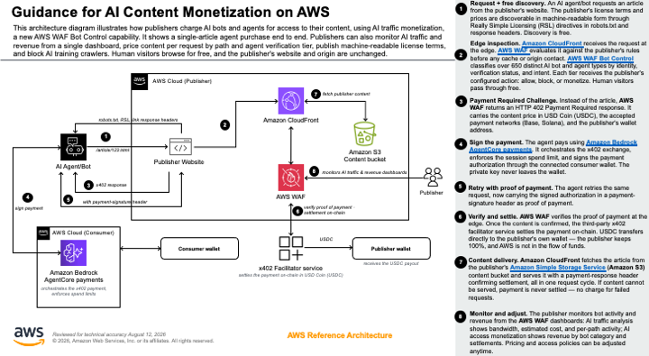
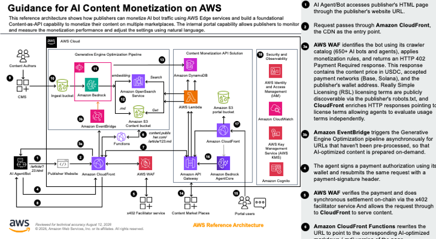

# Guidance for Publisher Content Monetization for AI Agents on AWS

## Table of Contents

1. [Overview](#overview)
    - [Architecture](#architecture)
    - [Cost](#cost)
2. [Prerequisites](#prerequisites)
    - [Operating System](#operating-system)
    - [Third-party tools](#third-party-tools)
    - [Python Dependencies](#python-dependencies)
    - [AWS account requirements](#aws-account-requirements)
    - [Supported Regions](#supported-regions)
3. [Deployment Steps](#deployment-steps)
4. [Deployment Validation](#deployment-validation)
5. [Running the Guidance](#running-the-guidance)
6. [Next Steps](#next-steps)
7. [Cleanup](#cleanup)
8. [FAQ, known issues, additional considerations, and limitations](#faq-known-issues-additional-considerations-and-limitations)
9. [Solution manifest](#solution-manifest)
10. [Revisions](#revisions)
11. [Notices](#notices)
12. [Authors](#authors)

## Overview

This Guidance implements the IAB Tech Lab **Content Monetization Protocol (CoMP)** on AWS so publishers can serve, license, and monetize their content to AI agents and large language models instead of having it scraped without compensation.

It provides a serverless control plane for content discovery, licensing, dynamic pricing, and usage analytics, plus a GEO (Generative Engine Optimization) enrichment pipeline that classifies and indexes content for semantic retrieval. AI operators authenticate and query content through a partner API; publishers manage content, pricing, and access rules through a web portal and an embedded analytics assistant.

Key capabilities:

- **CoMP-compliant partner API** — content discovery and query endpoints for AI agents, authenticated with Amazon API Gateway native API keys and usage plans.
- **GEO enrichment pipeline** — AWS Step Functions orchestration that extracts, classifies (IAB Content Taxonomy 3.1), embeds (Amazon Bedrock Titan v2), and indexes content into Amazon OpenSearch Serverless.
- **Dynamic pricing and licensing** — versioned pricing rules and RSL (Really Simple Licensing) terms, with optional pay-per-access enforcement at the edge.
- **Publisher portal** — a React dashboard for content management, pricing, bot-traffic visibility, and an AI analytics assistant on Amazon Bedrock AgentCore.
- **llms.txt discovery** — a managed, reviewable `llms.txt` manifest for AI discovery.

### Architecture

The Guidance supports two delivery scenarios over the same shared Amazon S3 content origin and Amazon CloudFront cache.

**Scenario 1 — Edge monetization.** The publisher's own website and CloudFront distribution charge AI bots and agents for access at the edge using AWS WAF (x402 payment challenge) and Really Simple Licensing (RSL) response headers. Human visitors browse for free; the publisher's site and origin are unchanged.



**Scenario 2 — Content-as-an-API.** A foundational control plane adds a GEO (Generative Engine Optimization) enrichment pipeline, a CoMP-compliant content API, semantic search, dynamic pricing, and a publisher portal on top of the same edge, so content can be discovered, licensed, and monetized across multiple marketplaces.



See the [Architecture Overview](./assets/docs/architecture-overview.md) for a component-level description, and the [API Specification](./assets/docs/api-specification.md), [Authentication Guide](./assets/docs/authentication-guide.md), and [Partner API Guide](./assets/docs/partner-api.md) for interface details.

**API contract (single source of truth):** [`openapi-spec.yaml`](./openapi-spec.yaml) is the OpenAPI 3.0 definition of the entire API surface — every path, request/response schema, status code, and security scheme. It is the authoritative contract that the API Gateway deployment, the handlers, and the in-portal developer reference are all generated from. The publisher portal ships an **interactive developer portal** (a [Scalar](https://github.com/scalar/scalar) reference at the portal's `/docs` route) that renders this same spec at runtime, lets you test endpoints with your signed-in session, and includes an **Internal | Partner** toggle so you can preview the exact partner-facing API surface external AI operators see.

The Guidance deploys as a set of AWS CDK stacks:

| Stack | Purpose |
|---|---|
| `CMCognitoStack` | Amazon Cognito user pool, identity pool, and role-based access for the publisher portal. |
| `ContentMonetizationStack` | Main API — Amazon API Gateway, AWS Lambda functions, Amazon DynamoDB tables, and Amazon S3 content storage. |
| `CMPipelineStack` | GEO enrichment pipeline — AWS Step Functions, the S3 ingest trigger, and the projection-backfill Lambda. |
| `CMSearchStack` | Amazon OpenSearch Serverless search collection (NextGen scale-to-zero group) and its endpoint parameter. Isolated in its own top-level stack so a release-version tag change cannot replace the collection and drop the index. |
| `CMBotControlStack` | Central-edge AWS WAF for the public API (traffic rules, optional pay-per-access). |
| `CMUIStack` | Publisher portal — React app on Amazon S3 and Amazon CloudFront. |

**Core AWS services:** Amazon API Gateway, AWS Lambda, Amazon DynamoDB, Amazon S3, Amazon Cognito, Amazon Bedrock (and Bedrock AgentCore), Amazon OpenSearch Serverless, AWS Step Functions, Amazon EventBridge, Amazon SQS, Amazon CloudFront, and AWS WAF.

### Cost

You are responsible for the cost of the AWS services used while running this Guidance. The architecture is serverless and billed on usage; cost scales with ingestion volume, query volume, and the OpenSearch Serverless and Bedrock capacity consumed.

As of October 2026, the primary standing cost in an idle environment is Amazon OpenSearch Serverless, which has a minimum OCU floor; the remaining services (Lambda, API Gateway, DynamoDB on-demand, S3, Cognito) bill per request and approach zero at zero traffic. Refer to the [AWS Pricing Calculator](https://calculator.aws/) to estimate the cost for your expected traffic profile and region.

We recommend creating a [budget](https://docs.aws.amazon.com/cost-management/latest/userguide/budgets-create.html) through AWS Cost Explorer to help manage costs. Prices are subject to change.

## Prerequisites

### Operating System

The project code uses the Python version of the AWS CDK ([Cloud Development Kit](https://aws.amazon.com/cdk/)). To execute the project code, please ensure that you have fulfilled the [AWS CDK Prerequisites for Python](https://docs.aws.amazon.com/cdk/latest/guide/work-with-cdk-python.html). Steps for a macOS machine are captured here; deployment on another OS may require additional steps.

1. Install Homebrew
```
/bin/bash -c "$(curl -fsSL https://raw.githubusercontent.com/Homebrew/install/HEAD/install.sh)"
```
2. Install Python 3.11+, Node.js, Git, and the AWS CLI
```
brew install python node git awscli
```
3. Configure an AWS CLI profile
```
aws configure --profile <profile name>
```

### Third-party tools

- **AWS CDK Toolkit** (`npm install -g aws-cdk`) — infrastructure deployment.
- **Node.js 18+** — building the React publisher portal.
- **Make** — the repository exposes all build, test, and deploy workflows as `make` targets (run `make help` to list them).

### Python Dependencies

Review [requirements.txt](./requirements.txt) (runtime/CDK) and [requirements-dev.txt](./requirements-dev.txt) (test/lint) for the Python dependencies. Create a virtual environment and install them:
```
python3 -m venv .venv && source .venv/bin/activate
pip install -r requirements.txt -r requirements-dev.txt
```

### AWS account requirements

- An AWS account with permission to deploy the services listed under [Architecture](#architecture).
- **Amazon Bedrock model access** enabled in your deployment region for the Titan Text Embeddings v2 and the Anthropic Claude model used by the enrichment pipeline (enable these in the Amazon Bedrock console under *Model access*).
- IAM permissions to create Amazon Cognito, API Gateway, Lambda, DynamoDB, S3, OpenSearch Serverless, Step Functions, CloudFront, and WAF resources.

#### AWS CDK bootstrap

The project requires the AWS account to be [bootstrapped](https://docs.aws.amazon.com/cdk/latest/guide/bootstrapping.html) before the CDK stacks can be deployed:
```
cdk bootstrap aws://<account-id>/<region> --profile <profile name>
```

### Supported Regions

This Guidance is developed and validated in **US West (Oregon) `us-west-2`**. It can be deployed in any AWS Region where all required services — in particular Amazon Bedrock (with the required model access) and Amazon OpenSearch Serverless — are available.

## Deployment Steps

1. Clone this repository:
```
git clone https://github.com/aws-solutions-library-samples/guidance-for-ai-content-monetization-on-aws.git
cd guidance-for-ai-content-monetization-on-aws
```

2. Create and activate a virtual environment and install dependencies:
```
python3 -m venv .venv && source .venv/bin/activate
pip install -r requirements.txt -r requirements-dev.txt
npm install -g aws-cdk
```

3. Review the infrastructure before deploying (synthesizes all stacks):
```
cdk synth --all -c account=<account-id> -c region=<region> --profile <profile name>
```

4. Deploy the backend (Cognito + main API stack, then taxonomy migration). A deploy never seeds or changes your content:
```
make deploy-cdk AWS_PROFILE=<profile name> AWS_REGION=<region>
```

5. Deploy the GEO enrichment pipeline and search collection (`CMPipelineStack`, then `CMSearchStack` — in that order; the pipeline frees the collection's fixed resource names before the search stack creates them):
```
make deploy-pipeline AWS_PROFILE=<profile name> AWS_REGION=<region>
```

6. Deploy the publisher portal (builds the React app and deploys the UI stack):
```
make deploy-ui AWS_PROFILE=<profile name> AWS_REGION=<region>
```

7. Optional: seed demo data (sample content, partners, pricing and analytics). It also registers the stack's test partner, so its API key works against the partner API right away. Without it, register partners in the portal first.
```
make seed-data AWS_PROFILE=<profile name> AWS_REGION=<region>
```
To reset to the demo data, add `CLEAR_EXISTING=true`. That deletes every document first: its record, its search entry and its stored objects. The S3 objects stay recoverable as noncurrent versions for 30 days, but the records and search entries don't, so restored content has to be ingested again.

> The `make deploy-*` targets wrap `cdk deploy` with the required cross-stack wiring (Cognito outputs passed to the main stack, and the taxonomy migration). Run `make help` to see all available targets.

## Deployment Validation

- Open the AWS CloudFormation console and confirm the stacks `CMCognitoStack`, `ContentMonetizationStack`, `CMPipelineStack`, `CMBotControlStack`, and `CMUIStack` show status `CREATE_COMPLETE` or `UPDATE_COMPLETE`.
- Confirm the API Gateway endpoint responds. The public discovery endpoint requires no authentication:
```
curl https://<api-id>.execute-api.<region>.amazonaws.com/v1/info
```
- Confirm the GEO pipeline state machine (`iab-geo-enrichment-pipeline`) exists in the AWS Step Functions console.
- Confirm the publisher portal loads at the Amazon CloudFront distribution URL output by `CMUIStack`.

## Running the Guidance

1. **Ingest content** — upload a content object under the `ingest/` prefix of the content S3 bucket, or submit it through the portal / `POST /content`. This triggers the Step Functions enrichment pipeline (extract → classify → embed → index → persist).
2. **Discover and query as an AI agent** — call the partner API with an API Gateway key (`x-api-key`). `GET /info` returns the discovery document; `POST /query` returns matching content, and each result's `url` reads that item with the same key (`GET /content?url=` or `GET /content?content_id=`). See the [Partner API Guide](./assets/docs/partner-api.md).
3. **Manage as a publisher** — sign in to the portal to manage content, configure pricing and licensing, review bot traffic, and use the analytics assistant.
4. **Explore the API** — open the **developer portal** at the portal's `/docs` route for an interactive, always-current reference generated from [`openapi-spec.yaml`](./openapi-spec.yaml). Browse endpoints by category, test them with your signed-in session, and switch between the Internal and Partner views to see exactly what external AI operators are exposed to.

Expected output: ingested content becomes discoverable through `POST /query` with its IAB categories, summary, and license reference populated by the pipeline.

## Next Steps

- Configure pricing tiers and RSL license terms for your content through the publisher portal.
- Register partners and provision API keys and usage plans for your AI-operator consumers.
- Enable pay-per-access enforcement at the edge if you want per-request monetization (see the central WAF stack configuration).
- Tune the enrichment pipeline model and OpenSearch Serverless capacity for your content volume.

### Scaling the content foundation with Media Lake

This Guidance ships a lightweight, self-contained GEO enrichment pipeline (extract → classify → embed → index) that is sufficient for text-centric content monetization. If you need a richer, enterprise-grade multimedia data foundation — ingesting and processing images, video, and audio at scale, with asset management, automated metadata extraction, and a searchable media catalog — consider deploying [**Media Lake on AWS**](https://docs.aws.amazon.com/solutions/a-media-lake-on-aws/) as an alternative content-processing backend. Media Lake provides a comprehensive, scalable multimedia pipeline that can feed enriched content and metadata into this monetization control plane in place of the repository's native pipeline.

## Cleanup

Destroy the deployed stacks when you are finished. Delete in reverse dependency order:
```
cdk destroy CMUIStack CMBotControlStack CMPipelineStack ContentMonetizationStack CMCognitoStack \
  -c account=<account-id> -c region=<region> --profile <profile name>
```

Amazon S3 buckets and Amazon CloudWatch log groups may be retained after stack deletion depending on their removal policy; delete them manually if no longer required.

## FAQ, known issues, additional considerations, and limitations

**Additional considerations**

- This Guidance is a reference implementation intended for evaluation and as a starting point. Review and harden it (least-privilege IAM, WAF rules, logging, secrets rotation, and region/account isolation) before using it in production.
- Amazon OpenSearch Serverless has a minimum capacity floor and is the primary standing cost in an idle environment; size and schedule it according to your traffic.
- Amazon Bedrock model access must be enabled in your deployment region, or the enrichment pipeline will fail at the classification/embedding step.
- **One deployment per AWS account and Region.** Several resources use fixed names so that the stacks can reference each other by name: the DynamoDB tables (`cm-content`, `cm-partners`, `cm-jobs`, `cm-analytics`, `cm-bot-rules`, `cm-pricing-rules`, `cm-pricing-transactions`, `cm-licenses`, `cm-taxonomy`, `cm-connections`, `cm-usage-events`, `iab-access-logs`), the OpenSearch Serverless collection (`cm-content-search`), the Lambda functions prefixed `iab-`, the `cm-llms-txt-worker-dlq` queue, and the `cm-partner-itest-quota` usage plan. A second copy of the Guidance in the same account and Region fails with a name conflict. Use a separate account or Region for each environment.

For feedback, questions, or suggestions, please use the Issues tab of this repository.

## Solution manifest

The repository root carries [`solution-manifest.yaml`](./solution-manifest.yaml) — the single source of truth for this Guidance's identity and release version:

```yaml
solution:
  id: SO9733
  name: Guidance for Publisher Content Monetization for AI Agents on AWS
  slug: guidance-for-ai-content-monetization-on-aws
  version: 0.2.0
```

The `version` field is the authoritative release version. Changes between releases are listed under `## [Unreleased]` in [CHANGELOG.md](./CHANGELOG.md). When cutting a release, bump the manifest `version` and rename that heading to `## [x.y.z] - YYYY-MM-DD` in the same change.

## Revisions

See [CHANGELOG.md](./CHANGELOG.md) for the revision history.

## Notices

*Customers are responsible for making their own independent assessment of the information in this Guidance. This Guidance: (a) is for informational purposes only, (b) represents AWS current product offerings and practices, which are subject to change without notice, and (c) does not create any commitments or assurances from AWS and its affiliates, suppliers or licensors. AWS products or services are provided "as is" without warranties, representations, or conditions of any kind, whether express or implied. AWS responsibilities and liabilities to its customers are controlled by AWS agreements, and this Guidance is not part of, nor does it modify, any agreement between AWS and its customers.*

## Authors

AWS Solutions Architecture team.
