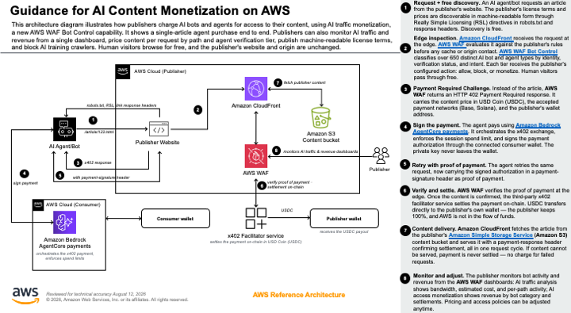
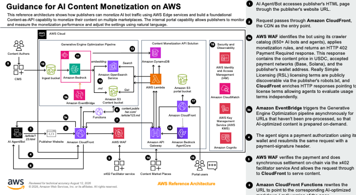

# Documentation

This directory contains the shipped documentation for the AI Content Monetization Guidance (the IAB Tech Lab **Content Monetization Protocol (CoMP)** implementation on AWS).

## 📚 Documentation

### Core
- **[Architecture Overview](architecture-overview.md)** — system architecture, components, and data flow.
- **[API Specification](api-specification.md)** — conceptual API guide; the authoritative contract is [`openapi-spec.yaml`](../../openapi-spec.yaml).
- **[Authentication Guide](authentication-guide.md)** — authentication planes (native API keys and Cognito) and flows.
- **[Partner API Guide](partner-api.md)** — the AI-operator consumer walkthrough (discover → query).

### Capability guides
- **[Native Edge Delivery](native-edge-delivery.md)** — deterministic private Markdown delivery through Amazon CloudFront.
- **[Managed llms.txt](managed-llms-txt.md)** — the reviewable `llms.txt` generation/publish lifecycle and verification notes.

### Interactive reference
The publisher portal ships an interactive developer portal — a [Scalar](https://github.com/scalar/scalar) reference at the portal's **`/docs`** route. It renders [`openapi-spec.yaml`](../../openapi-spec.yaml) live, lets you test endpoints with your signed-in session, and has an **Internal | Partner** toggle to preview the exact partner-facing surface external AI operators see.

## 🚀 Quick start

For a new deployment, start with the repository [README](../../README.md):
1. **Deployment Steps** — get the stacks running.
2. [API Specification](api-specification.md) + the `/docs` portal — understand the endpoints.
3. [Authentication Guide](authentication-guide.md) — configure access for publishers and partners.

## 🏗️ Architecture at a glance

The Guidance supports two delivery scenarios over the same shared Amazon S3 origin and Amazon CloudFront cache:

- **Edge monetization** — the publisher's own CloudFront + AWS WAF charges AI agents at the edge (x402 / RSL).

  

- **Content-as-an-API** — a serverless control plane adds the GEO enrichment pipeline, the CoMP content API, semantic search, dynamic pricing, and the publisher portal.

  

See the [Architecture Overview](architecture-overview.md) for the component-level description.

## 📋 Key features

- **CoMP-compliant partner API** — discovery and query for AI agents, authenticated with **Amazon API Gateway native API keys and usage plans** (`x-api-key`); publishers authenticate with **Amazon Cognito JWT**.
- **GEO enrichment pipeline** — AWS Step Functions extract → classify (IAB Content Taxonomy 3.1) → embed (Amazon Bedrock Titan v2) → index into **Amazon OpenSearch Serverless**.
- **Dynamic pricing & RSL licensing** — versioned pricing rules and Really Simple Licensing terms, with optional edge pay-per-access.
- **Publisher portal** — React dashboard for content, pricing, bot-traffic visibility, and an analytics assistant on Amazon Bedrock AgentCore.

## 🔗 External resources

- [IAB Tech Lab Content Monetization Protocol](https://iabtechlab.com/)
- [AWS CDK Documentation](https://docs.aws.amazon.com/cdk/)
- [Amazon Bedrock User Guide](https://docs.aws.amazon.com/bedrock/)
