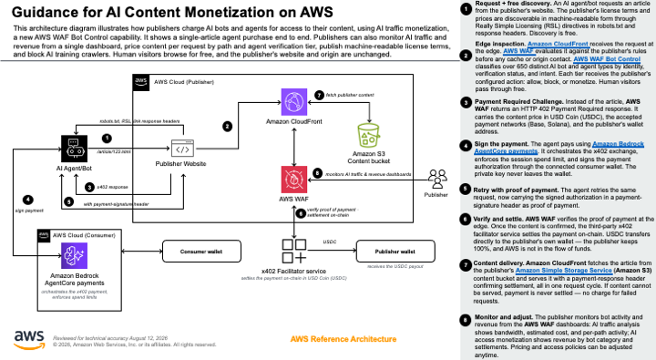
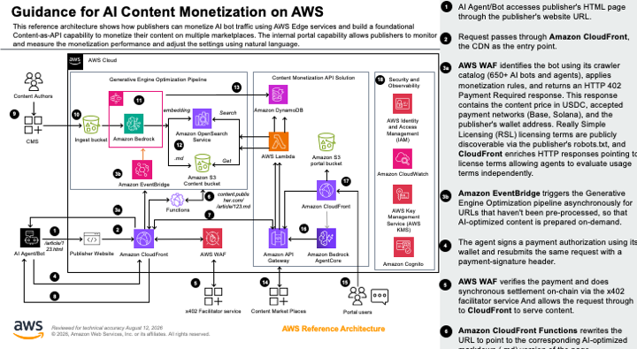

# Architecture Overview

## System Architecture

The AI Content Monetization Guidance implements the IAB Tech Lab **Content Monetization Protocol (CoMP)** on an AWS serverless architecture, providing a scalable, pay-per-use solution for publisher content monetization and AI-agent integration.

The Guidance supports two delivery scenarios over the same shared Amazon S3 content origin and Amazon CloudFront cache:

**Scenario 1 — Edge monetization.** The publisher's own CloudFront distribution charges AI bots and agents at the edge using AWS WAF (x402 payment challenge) and Really Simple Licensing (RSL) response headers.



**Scenario 2 — Content-as-an-API.** A serverless control plane adds a GEO enrichment pipeline, a CoMP-compliant content API, semantic search, dynamic pricing, and a publisher portal on top of the same edge.



## Core Components

### API Gateway
- RESTful API (OpenAPI 3.0 contract — see [`openapi-spec.yaml`](../../openapi-spec.yaml)) with CORS and throttling
- Two authentication models: **native API keys + usage plans** for the partner (AI-operator) plane, and **Amazon Cognito JWT** for the publisher/internal plane
- Request routing to the partner-API and UI-backend Lambda functions
- Per-key rate limiting and quota through usage plans

### Lambda Functions
- **Partner API** (`partner_api`): CoMP discovery and query for AI operators (`/info`, `/query`, `/log`, `/taxonomy`, `/llms.txt`), authenticated with API Gateway native keys (`x-api-key`)
- **UI Backend** (`ui_backend`): publisher content, pricing, analytics, partner, and llms.txt management operations behind Cognito auth
- **GEO content pipeline** (`content_pipeline`): Step Functions-dispatched extract / classify-enrich / embed / index / persist steps
- **Shared supporting functions**: authentication service/authorizer, access logging, access-rules engine, and analytics aggregation

### Data Layer
- **Amazon DynamoDB** (`cm-*` tables): content (`cm-content`), partners (`cm-partners`), processing jobs (`cm-jobs`), analytics (`cm-analytics`), bot rules (`cm-bot-rules`), pricing rules and transactions (`cm-pricing-rules`, `cm-pricing-transactions`), IAB taxonomy (`cm-taxonomy`), RSL licenses (`cm-licenses`), and integration connections (`cm-connections`)
- **Amazon S3**: content storage — the shared private origin for ingested objects and the generated `.md` renditions served through CloudFront
- **Amazon OpenSearch Serverless**: the hybrid (vector + keyword) search index that backs content discovery and `/query`

### AI Services
- **Amazon Bedrock**: Titan Text Embeddings v2 for semantic embeddings, and an Anthropic Claude model for IAB classification and GEO enrichment (answer capsules, FAQ schema)
- **Amazon Bedrock AgentCore**: hosts the publisher analytics assistant

### Authentication
- **Amazon Cognito**: publisher-portal authentication with JWT tokens (External OIDC-capable)
- **API Gateway native API keys + usage plans**: per-partner authentication, throttling, and quota for AI operators
- **Two-plane model**: an internal plane (Cognito) and a partner plane (native key / public) over the same backend Lambdas

## Data Flow

### Content Ingestion & Enrichment Flow
```
Publisher/CMS → S3 ingest/ → EventBridge → Step Functions
  (extract → classify + GEO enrich → embed → index → persist)
  → OpenSearch Serverless (search) + DynamoDB (metadata) + S3 (.md rendition)
```

### AI Agent Access Flow
```
AI Agent → API Gateway (x-api-key) → Partner API Lambda
  → OpenSearch Serverless discovery → content retrieval → async usage logging
```

### Publisher Management Flow
```
Publisher → Cognito Auth → UI Backend Lambda → content / pricing / analytics
```

## Scalability Features

- **Serverless architecture**: Lambda, API Gateway, DynamoDB on-demand, and OpenSearch Serverless auto-scale with demand
- **Hybrid semantic search**: vector + BM25 retrieval over OpenSearch Serverless
- **Caching**: API Gateway stage caching for the public discovery GETs (`/info`, `/taxonomy`, `/llms.txt`)
- **Edge delivery**: Amazon CloudFront serves cached `.md` content globally from the shared S3 origin

## Security Architecture

- **HTTPS only**: all traffic encrypted in transit
- **Private S3 origin (OAC)**: content objects are reachable only through the gated CloudFront edge, never directly
- **IAM roles**: least-privilege execution roles for Lambda and the pipeline
- **AWS WAF**: edge protection and x402 / pay-per-access enforcement
- **AWS KMS**: encryption for data at rest

## Monitoring & Observability

- **Amazon CloudWatch**: structured logging and metrics across Lambda, Step Functions, and the API
- **Analytics assistant**: natural-language insight over usage and revenue data
- **Audit trails**: request/usage logging to the analytics store

## Cost Optimization

- **Pay-per-use**: serverless pricing across Lambda, API Gateway, and DynamoDB on-demand
- **OpenSearch Serverless capacity**: scale-to-floor OCUs sized to traffic (the primary standing cost at idle)
- **S3 lifecycle / Intelligent-Tiering**: automatic storage cost optimization
- **DynamoDB on-demand**: automatic scaling without capacity planning
