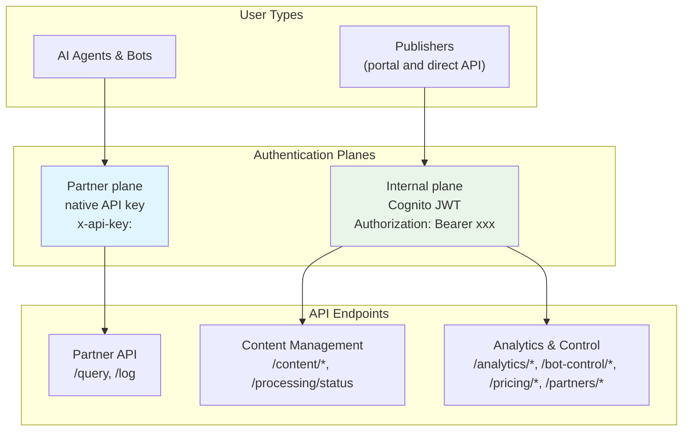
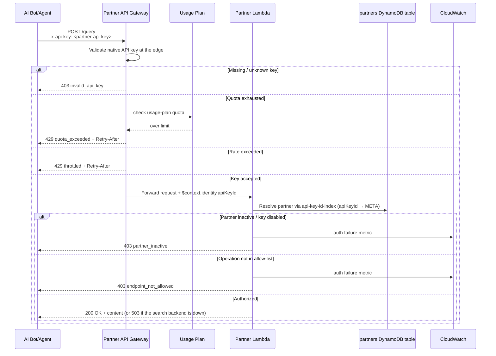
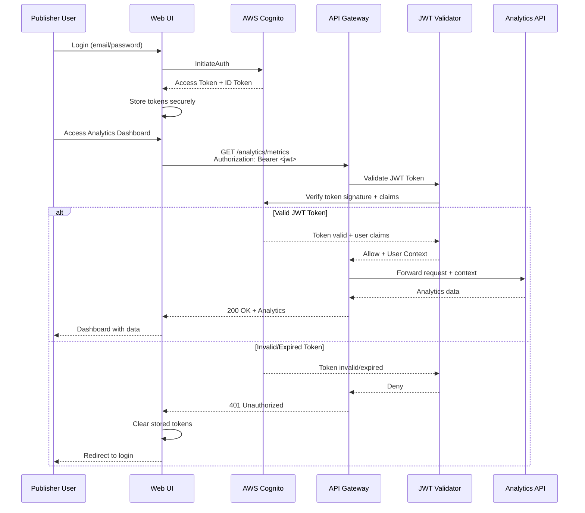

# Authentication Guide

This document describes the two-plane authentication model implemented in the IAB CoMP API.

## Overview

The API implements **two authentication planes** over the same backend, one per audience:

1. **Partner plane — API Gateway native API keys** (`x-api-key`): AI operators and external agents.
   Keys are validated at the edge with usage-plan throttle and quota.
2. **Internal plane — Amazon Cognito JWT** (`Authorization: Bearer <token>`): publishers, for the
   web portal and for direct API access to content, pricing, licensing, analytics, and bot control.

A small set of discovery endpoints (`/info`, `/taxonomy`, `/llms.txt`, `/.well-known/comp.json`)
are **public** (no authentication).

## Authentication Architecture



## Authentication Flow Details

### 1. Partner Key Authentication Flow

**Use Case**: AI agents, LLM providers, and external bots accessing content

Partner authentication uses **API Gateway native API keys and usage plans**, served on a dedicated
**partner API** (separate from the internal Cognito API). The key is validated at the edge by API
Gateway itself — there is no custom Lambda request authorizer and no DynamoDB quota counter. The
Lambda only *resolves* the partner behind the key (for `partner_id`, `pricing_tier` and the
allow-list); it does not authenticate.



**Implementation Details**:
- Keys are **API Gateway native API keys**; the raw value is never stored in the application. The
  key id (`$context.identity.apiKeyId`) is the only identifier the Lambda sees.
- Partner resolution is a single DynamoDB lookup on the `api-key-id-index` GSI of the partners table
  (`apiKeyId` → the partner's `PARTNER#<id>` / `META` item). Credentials are child `KEY#<apiKeyId>`
  items.
- **Quota and rate limiting are enforced by the usage plan at the edge**, one plan per pricing tier.
  There is no `api_quota`/`api_usage` counter in DynamoDB.
- The allow-list (`allowed_endpoints`) is enforced in the Lambda after resolution; empty means all
  key-gated operations are permitted.
- Comprehensive logging for billing and analytics keys on `partner_id` + `api_key_id` (never the key
  value).

### Partner lifecycle (create, rotate, retire, suspend, delete)

Publishers manage partners from the UI or the Cognito-authenticated `/partners` API on the
internal plane (`ApiGatewayUrl`); the partner plane never exposes these operations.

- **Create** (`POST /partners`): validates the request, writes the `META` item, and for a `direct`
  identity provisions the first API key on the tier's usage plan — the key value is returned once
  and never stored. The key is tagged with the `partner_id` so an interrupted provision can be
  reconciled (`PartnersService.reconcile_keys` deletes gateway keys the table does not record).
- **Rotate** (`POST /partners/{id}/keys`): a new key is provisioned, then the previous keys are
  disabled (not deleted) so an in-flight caller fails closed. Rotated-out keys are marked
  `disabled_reason = rotated` and are **never** re-enabled by a later reactivation.
- **Suspend / reactivate** (`PUT /partners/{id}` with `status`): suspending disables every key at
  API Gateway (`disabled_reason = suspended`); reactivating re-enables only those.
- **Tier change** (`PUT /partners/{id}` with `pricing_tier`): every key is moved to the new tier's
  usage plan; quota and throttle follow the plan.
- **Retire** (`DELETE /partners/{id}/keys/{key_id}`): permanently deletes a key; refused with
  `409 conflict` while it is the only active key.
- **Delete** (`DELETE /partners/{id}`): soft-deletes `META` (`status = deleted`) and deletes all
  keys from the plan, the gateway and the table.

Limits (`tier_limits`) are read from the usage plan and per-key consumption (`usage`) from
`GetUsage` over the plan's current quota period (`DAY`, `WEEK` or `MONTH`); both degrade to `null`
if the gateway cannot answer rather than failing the read.

### 2. Cognito JWT Authentication Flow

**Use Case**: Publishers accessing the web portal, analytics, content management, pricing, licensing, and bot control — the internal plane.



**JWT Token Structure**:
```json
{
  "header": {
    "alg": "RS256",
    "typ": "JWT",
    "kid": "cognito-key-id"
  },
  "payload": {
    "iss": "https://cognito-idp.us-west-2.amazonaws.com/us-west-2_EXAMPLE01",
    "aud": "cognito-app-client-id",
    "token_use": "access",
    "sub": "user-uuid",
    "cognito:username": "publisher@example.com",
    "exp": 1640995200,
    "iat": 1640908800,
    "custom:publisher_id": "pub_123",
    "custom:permissions": ["analytics", "content_management"]
  }
}
```

## Endpoint Access Matrix

| Endpoint Category | Partner Key | Cognito JWT | Public |
|------------------|-------------|-------------|--------|
| **Content Discovery** | | | |
| `/info` | ✅ | — | ✅ |
| `/taxonomy` | ✅ | — | ✅ |
| `/llms.txt` | ✅ | — | ✅ |
| `/.well-known/comp.json` | ✅ | — | ✅ |
| **Content Access (partner)** | | | |
| `/query` | ✅ | ✅ (internal plane) | ❌ |
| `/log` | ✅ | ❌ | ❌ |
| **Content Management (internal)** | | | |
| `/content/*` | ❌ | ✅ | ❌ |
| `/content/llms-txt*` | ❌ | ✅ | ❌ |
| `/processing/status` | ❌ | ✅ | ❌ |
| **Pricing & Licensing (internal)** | | | |
| `/pricing/*` | ❌ | ✅ | ❌ |
| `/licenses/*` | ❌ | ✅ | ❌ |
| **Partners, Analytics & Control (internal)** | | | |
| `/partners/*` | ❌ | ✅ | ❌ |
| `/analytics/*` | ❌ | ✅ | ❌ |
| `/analytics-agent/chat` | ❌ | ✅ | ❌ |
| `/bot-control/*` | ❌ | ✅ | ❌ |
| `/connections/*` | ❌ | ✅ | ❌ |

> `/query` and `/licenses/{id}/validate` are reachable on both planes: with a native key on the
> partner API, and with Cognito on the internal API. See [`openapi-spec.yaml`](../../openapi-spec.yaml)
> for each operation's exact `security` block and `x-audience`.

## Security Implementation

### API Key Security
- **Storage**: Partner keys are API Gateway native API keys; the raw value is never stored by the
  application (only the key id is persisted, on the partner's `KEY#` item)
- **Validation**: At the API Gateway edge; the Lambda resolves the partner from the key id
- **Rate Limiting**: Usage-plan quota and throttle per pricing tier, enforced at the edge
- **Monitoring**: CloudWatch metrics for all auth events

### JWT Security
- **Validation**: Real-time verification against Cognito
- **Expiration**: Configurable token lifetime (default 24h)
- **Refresh**: Automatic token refresh in UI
- **Claims**: Custom claims for permissions and roles

### Common Security Measures
- **HTTPS Only**: All authentication requires encrypted transport
- **Audit Logging**: Comprehensive logging of all auth events
- **Error Handling**: Secure error messages without information leakage
- **Monitoring**: Real-time alerting on authentication anomalies

## Error Handling

### Authentication Errors

| Error Code | Scenario | Response | Action |
|------------|----------|----------|---------|
| `403` | Missing / unknown partner key (gateway) | `{"error_code": "invalid_api_key"}` | Provide a valid `x-api-key` |
| `403` | Key resolves but partner inactive / key disabled | `{"error_code": "partner_inactive"}` | Check partner status |
| `403` | Operation not in the partner's allow-list | `{"error_code": "endpoint_not_allowed"}` | Request access to the operation |
| `429` | Usage-plan quota exhausted | `{"error_code": "quota_exceeded"}` + `Retry-After` | Wait for the quota window to reset |
| `429` | Rate/burst throttled | `{"error_code": "throttled"}` + `Retry-After` | Reduce request rate |
| `401` | Missing / invalid Cognito JWT (internal plane) | `{"error": "Unauthorized"}` | Re-authenticate |
| `403` | Insufficient permissions (internal plane) | `{"error": "Access denied"}` | Check endpoint permissions |

### Error Response Format
```json
{
  "error": "Forbidden",
  "error_code": "invalid_api_key",
  "message": "The provided API key is invalid or inactive",
  "timestamp": "2024-01-15T10:30:00Z",
  "request_id": "req_abc123def456"
}
```

## Testing Authentication Flows

### Unit Tests
```bash
# Test authentication service functions
make test-auth-flows

# Test specific authentication scenarios
python -m pytest tests/auth/test_dual_auth_integration.py::TestDualAuthenticationIntegration::test_partner_key_authentication_flow -v
```

### Integration Tests
```bash
# Test with live AWS services (requires credentials)
RUN_LIVE_TESTS=true make test-auth-flows

# Test API Gateway authorizer integration
python -m pytest tests/auth/test_dual_auth_integration.py::TestDualAuthenticationIntegration::test_api_gateway_authorizer_integration -v
```

### Manual Testing

#### Partner Key Testing
```bash
# Valid partner key (POST /query on the partner API host)
curl -X POST -H "x-api-key: <partner-api-key>" -H "Content-Type: application/json" \
     -d '{"query":"technology news","content_type":["article"],"max_results":5}' \
     https://<partner-api-id>.execute-api.us-west-2.amazonaws.com/v1/query

# Missing/invalid key -> 403 invalid_api_key
curl -X POST -H "x-api-key: invalid_key" -H "Content-Type: application/json" \
     -d '{"query":"technology news"}' \
     https://<partner-api-id>.execute-api.us-west-2.amazonaws.com/v1/query
```

#### Cognito JWT Testing
```bash
# Get Cognito token (requires setup)
aws cognito-idp admin-initiate-auth \
  --user-pool-id us-west-2_EXAMPLE01 \
  --client-id your-client-id \
  --auth-flow ADMIN_USER_PASSWORD_AUTH \
  --auth-parameters USERNAME=user@example.com,PASSWORD=password

# Use token for API access
curl -H "Authorization: Bearer <jwt-token>" \
     https://your-api.amazonaws.com/v1/analytics/metrics
```

## Configuration

### Environment Variables
```bash
# Authentication service configuration
JWT_SECRET_NAME=iab-jwt-secret
JWT_EXPIRY_HOURS=24
# The partners table has a CloudFormation-generated name (see the PartnerTableName stack output);
# the stack injects it as PARTNER_TABLE_NAME. Usage plans are resolved by name prefix.
PARTNER_TABLE_NAME=ContentMonetizationStack-PartnerTable…
USAGE_PLAN_NAME_PREFIX=cm-partner-

# Cognito configuration
COGNITO_USER_POOL_ID=us-west-2_EXAMPLE01
COGNITO_CLIENT_ID=your-client-id
COGNITO_REGION=us-west-2
```

### DynamoDB Table Schemas

#### Partners Table (`PartnerTableName` output)

Keyed on partner identity: a `META` item per partner plus one `KEY#<apiKeyId>` child per credential.
GSI `api-key-id-index` (PK `api_key_id`) resolves a request's `$context.identity.apiKeyId` to its
partner in one query. There is no `partner_key_hash`, `api_quota` or `api_usage` — the raw key lives
only in API Gateway and quota is a usage-plan concern.

```json
// META item
{
  "PK": "PARTNER#partner_123",
  "SK": "META",
  "partner_id": "partner_123",
  "partner_name": "AI Provider Inc",
  "status": "active",
  "pricing_tier": "standard",
  "allowed_endpoints": ["queryContent", "submitLog"],
  "identity_source": "direct",
  "created_at": "2024-01-01T00:00:00Z",
  "updated_at": "2024-01-15T10:30:00Z"
}
// credential item
{
  "PK": "PARTNER#partner_123",
  "SK": "KEY#abcd1234ef",
  "partner_id": "partner_123",
  "api_key_id": "abcd1234ef",
  "usage_plan_id": "n2e5wv",
  "status": "active",
  "created_at": "2024-01-01T00:00:00Z"
}
```

## Monitoring and Analytics

### CloudWatch Metrics
- `IAB/Authentication/AuthenticationFailures`
- `IAB/Authentication/SuccessfulAuthentications`
- `IAB/Authentication/QuotaExceeded`
- `IAB/Authentication/TokenRefreshes`

### Logging
- All authentication attempts (success/failure)
- Rate limiting events
- Token lifecycle events
- Security anomalies

### Alerting
- High authentication failure rates
- Quota exceeded events
- Suspicious access patterns
- Token validation errors

## Best Practices

### For AI Operators
1. **Secure Key Storage**: Store partner keys securely, never in code
2. **Rate Limiting**: Implement client-side rate limiting
3. **Error Handling**: Handle 401/429 responses gracefully
4. **Monitoring**: Monitor usage against quotas

### For Publishers
1. **Token Management**: Implement secure token storage and refresh
2. **Session Management**: Handle token expiration gracefully
3. **Permissions**: Use least-privilege access patterns
4. **Monitoring**: Monitor authentication events

### For Developers
1. **Testing**: Comprehensive testing of all auth flows
2. **Security**: Regular security audits and penetration testing
3. **Monitoring**: Real-time monitoring of authentication metrics
4. **Documentation**: Keep authentication documentation current

## Troubleshooting

### Common Issues

#### `invalid_api_key` (403) errors
- Verify the `x-api-key` header is present and the key is enabled in API Gateway
- A freshly provisioned key is eventually consistent through its usage plan — allow a few seconds
- Check the partner's `META` status and the key's `KEY#` status in the partners table

#### JWT token validation failures
- Check token expiration
- Verify Cognito configuration
- Ensure proper token format (Bearer prefix)

#### Rate limiting issues
- Check current usage against quota
- Implement exponential backoff
- Contact support for quota increases

### Debug Commands
```bash
# Resolve a partner from an API key id (as the Lambda does)
aws dynamodb query \
  --table-name "$(aws cloudformation describe-stacks --stack-name ContentMonetizationStack \
      --query "Stacks[0].Outputs[?OutputKey=='PartnerTableName'].OutputValue" --output text)" \
  --index-name api-key-id-index \
  --key-condition-expression "api_key_id = :k" \
  --expression-attribute-values '{":k": {"S": "<apiKeyId>"}}'

# Verify Cognito configuration
aws cognito-idp describe-user-pool \
  --user-pool-id us-west-2_EXAMPLE01

# Check authentication logs
aws logs filter-log-events \
  --log-group-name /aws/lambda/authentication-service \
  --filter-pattern "ERROR"
```